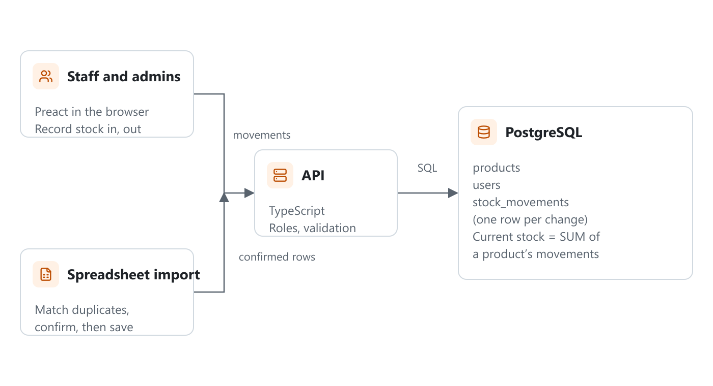

## Background (What are we solving?)

The business tracked its stock in a shared spreadsheet. Staff updated it from memory at the end of the day, numbers drifted from what was actually on the shelves, and when a count was wrong there was no way to tell who had changed it or when.

## My Role

I built the system on my own as an in-house tool. I worked out the requirements with the staff who handle stock every day, then designed the database and built the app.

## Solution (What is Inventory Tracker?)

Inventory Tracker is a web app that replaces the spreadsheet.

- Staff record stock coming in and going out as it happens, with a reason for each change.
- Every product has a full history showing who changed its stock, by how much and why.
- Products below a minimum level are flagged on the dashboard so they can be reordered in time.
- Admins manage products and accounts; regular staff can only record stock movements.

## Design & Architecture (How does it work?)

The frontend is Preact with TypeScript, backed by a PostgreSQL database.

The key design decision was to never store a stock level that people edit directly. Instead, each change is saved as a row in a **stock_movements** table, and the current level is the sum of a product's movements. That means the history can't drift away from the totals, and a wrong number can always be traced back to the movement that caused it.

## Challenges

Moving the existing spreadsheet into the new system was harder than building the app. The same product often appeared under slightly different names, and some rows had counts with no dates. I wrote an import step that groups likely duplicates and lets a staff member confirm each match before anything is saved, then records the imported counts as each product's opening stock.

## Outcome

The team uses Inventory Tracker for daily stock checks instead of the spreadsheet, and low-stock items are spotted before they run out.

## What I Learned

Modelling changes as an append-only list of events, rather than one number that keeps being overwritten, made both auditing and debugging much easier. I'd reach for the same pattern again for anything involving money or stock.
