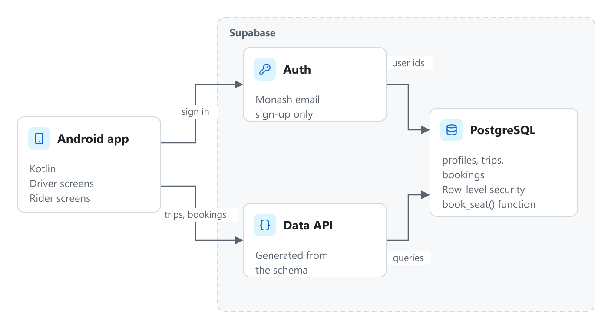

## Background (What are we solving?)

A lot of Monash students drive to campus with empty seats, while others spend over an hour on buses for the same trip. General rideshare apps don't help much here: they're built for paid one-off rides, not for regular trips between students who are all heading to the same place.

## My Role

Mogo was a team project. I worked mainly on the trip booking flow in the Android app and on the Supabase database design, including the access rules that decide who can see which trips and bookings.

## Solution (What is Mogo?)

Mogo is an Android app for sharing rides between Monash students.

- Sign-up only accepts Monash email addresses, so everyone on the app is a student or staff member.
- Drivers post a trip with a start point, a campus, a departure time and the number of free seats.
- Riders search for trips to their campus, request a seat, and get notified when the driver accepts.
- Both sides can see upcoming and past trips in one place.

## Design & Architecture (How does it work?)

The app is written in Kotlin in Android Studio. Supabase provides authentication and a PostgreSQL database, so there's no separate backend server to maintain.

The main tables are **profiles**, **trips** and **bookings**. Postgres row-level security policies enforce the access rules in the database itself. For example, a rider can only read their own bookings, and only a trip's driver can accept or decline requests for it.

## Challenges

Two riders could request the last seat on a trip at the same moment, and both bookings would go through. Checking the seat count in the app first didn't help, because both checks happened before either booking was saved. I moved booking into a single Postgres function that checks and decrements the seat count in one transaction, so the second request is rejected cleanly.

## Outcome

We demoed Mogo at the end of semester, running on our own phones against a shared Supabase project. The source is on GitHub.

## What I Learned

Putting access rules and booking logic in the database, instead of trusting the app, made the whole system simpler to reason about. It's also where I first had to think properly about two requests happening at once.
