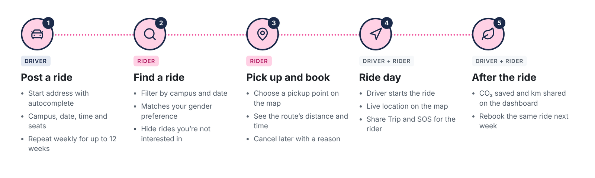
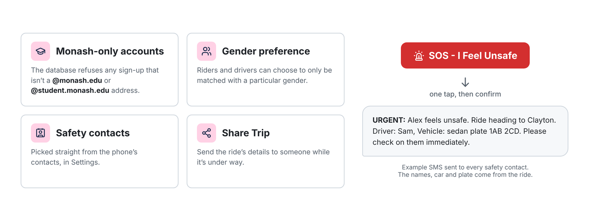

***Note:** To DC and Green Lantern fans, the project name was not intended to be a reference to the Green Lantern character: [Mogo](https://en.wikipedia.org/wiki/Mogo), but was instead a play on words on "Monash Uni" + "Go". Nonetheless, I find it quite a cute coincidence.*

## Background (What are we solving?)

A lot of Monash students drive to campus with empty seats, while others spend over an hour on buses for the same trip. General rideshare apps don't help much here: they're built for paid one-off rides, not for regular trips between students who are all heading to the same place.

## My Role

I worked mainly on integrating Google Maps and helping with the user booking flows.

## Solution (What is Mogo?)

Mogo is an Android app for sharing rides between Monash students &amp; staff.

- Sign-up only accepts valid Monash email addresses, so everyone on the app is a student or staff member.
- Drivers post a trip with a start point, a campus, a departure time and the number of free seats.
- Riders search for trips to their campus, request a seat, and get notified when the driver accepts.
- Both sides can see upcoming and past trips in one place.

## Design & Architecture (How does it work?)

The app is written in Kotlin in Android Studio. Supabase provides authentication and a PostgreSQL database, so there's no separate backend server to maintain. We used Google Maps SDK (Maps API, Routes API) to display the map interface, allowing both Riders and Drivers to see their locations and the route they will take to reach their destination.

The main tables are **profiles**, **trips** and **bookings**. Postgres row-level security policies enforce the access rules in the database itself. For example, a rider can only read their own bookings, and only a trip's driver can accept or decline requests for it.

## Challenges

Two riders could request the last seat on a trip at the same moment, and both bookings would go through. Checking the seat count in the app first didn't help, because both checks happened before either booking was saved. I moved booking into a single Postgres function that checks and decrements the seat count in one transaction, so the second request is rejected cleanly.

## Outcome

We demoed Mogo at the end of semester, running the app on the virtual device emulator on Android Studio and on our own (physical) phones against a shared Supabase project. The source is on GitHub.

***Note**: The GitHub repo link attached to this project is a fork of the original team repo.*

## What I Learned

Putting access rules and booking logic in the database, instead of trusting the app, made the whole system simpler to reason about. It's also where I first had to think properly about two requests happening at once.
