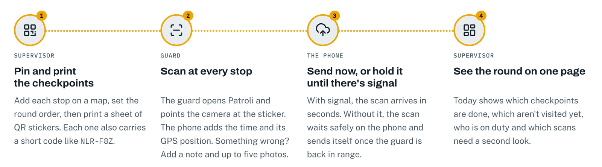
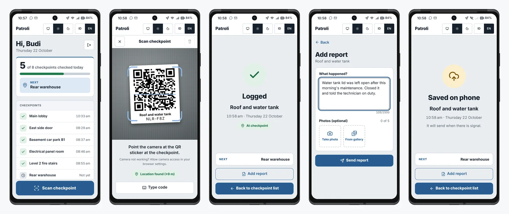
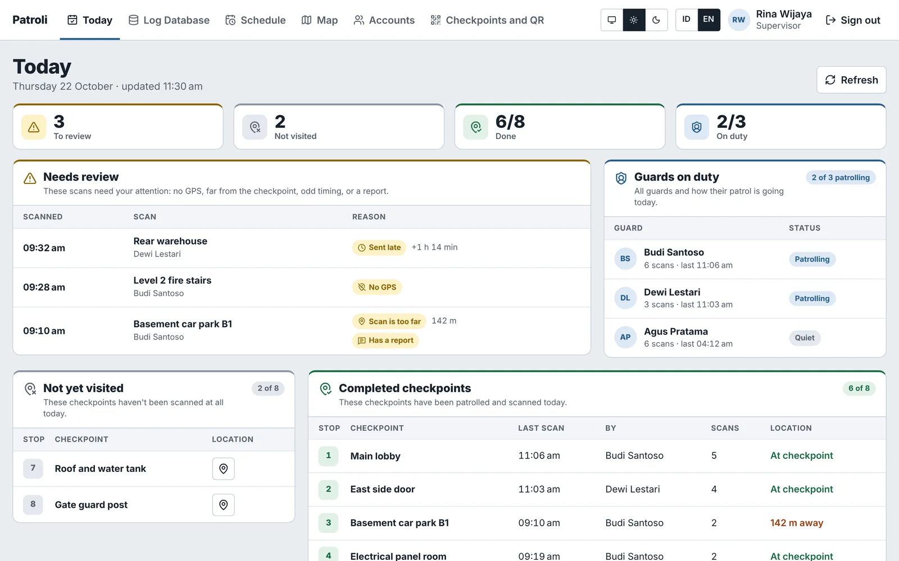
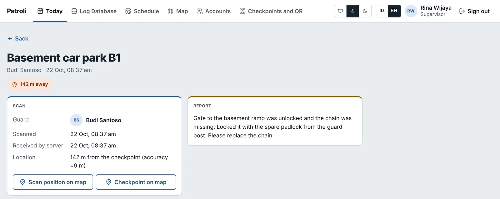
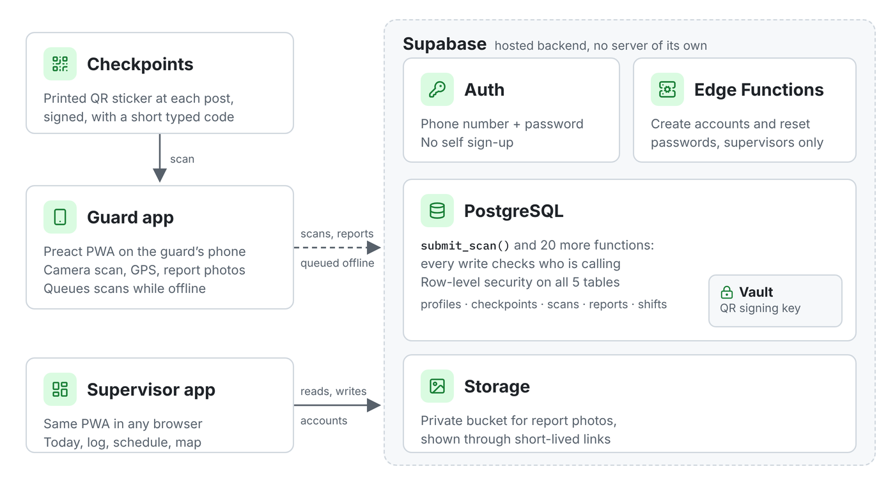
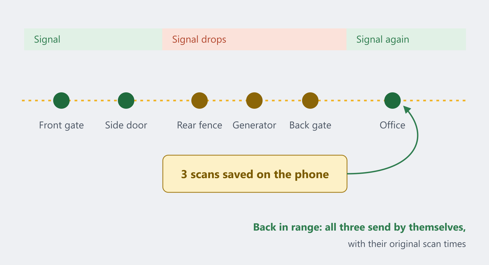

## Background

A business owner once came up to me with a specific problem they wanted to solve: **to easily monitor if the security guards they hired had actually completed their assigned patrols**. Checking the CCTV everyday can be time-consuming, and guards might not always be truthful.

They proposed a modernized version of the [Watchclock](https://en.wikipedia.org/wiki/Watchclock) system, which used to be popular before the rise in electronic systems. Briefly explained, this is how the original system worked:

- Each guard would be given a mechanical clock inside a locked case. Inside it is a paper tape (or disc) that advances with time.
- Each lock (or locked case) can only be opened using its corresponding key.
- Each location (checkpoint) holds a unique key (commonly chained to the site).
- Each key has its own embossed number or pattern.
- A guard needs to use the keys to stamp the key's number onto the clock's paper tape, marking the current time position.
- Supervisors (with the keys) regularly check the timestamps against the guards' assigned schedule.

## My Role

I worked with the owner to asses the situation, gather functional and non-functional requirements. Then, I planned and designed the platform, starting from UI/UX to how it connects to the database and hosting.

<!-- I gathered requirements with the owner, designed the screens, built the frontend and the API, and set up the database and hosting. -->

## Requirements (What are we solving?)

TODO: UPDATEEE.

## Solution (What is Patroli?)

The platform has two user roles:

- **Supervisor:** Someone who checks what locations have been visited and who they've been visited by.
- **Guard:** Someone who patrols the perimeter of a location, and logs their visited assigned checkpoints.

Every checkpoint on a site has a printed QR code. During a round, the guard scans each code with their phone's camera, and Patroli records the checkpoint, the guard and the time.

The supervisor's dashboard shows each site's checkpoints for the current shift, with missed or late ones highlighted, and a history the owner can look back through.

Additionally, guards can also submit images and text reports for each checkpoint (if they find any).

## Design & Architecture (How does it work?)

The frontend is a Preact progressive web app written in TypeScript, which is what lets guards install it on their phones without going through an app store. It talks to a TypeScript API backed by PostgreSQL.

The data model is small:

- **sites** and their **checkpoints**, each checkpoint with its own QR code
- **guards** and **supervisors**, with a role on each account
- **scans**: one row per checkpoint visit (guard, checkpoint, timestamp)

Patrol progress is calculated from the scans, so there's no separate status to keep in sync.

## Challenges

Some checkpoints sat in car parks and stairwells with no mobile signal, so scans were failing at exactly the places that most needed checking. I changed the scan flow so a scan is saved on the phone first and sent to the server when the connection comes back, keeping the time of the scan, not the time it was uploaded.

## Outcome

The owner now checks patrols from the dashboard during the shift instead of waiting for the logbook, and can see straight away when a checkpoint has been missed.

- Available on both light & dark mode.
- Available on 2 languages (English & Bahasa Indonesia/Indonesian Language).
- Available on mobile and desktop (either as websites or installable applications).
